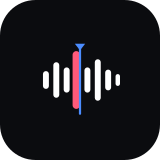
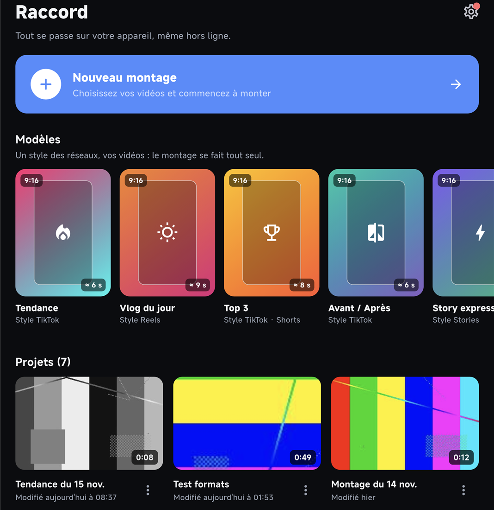
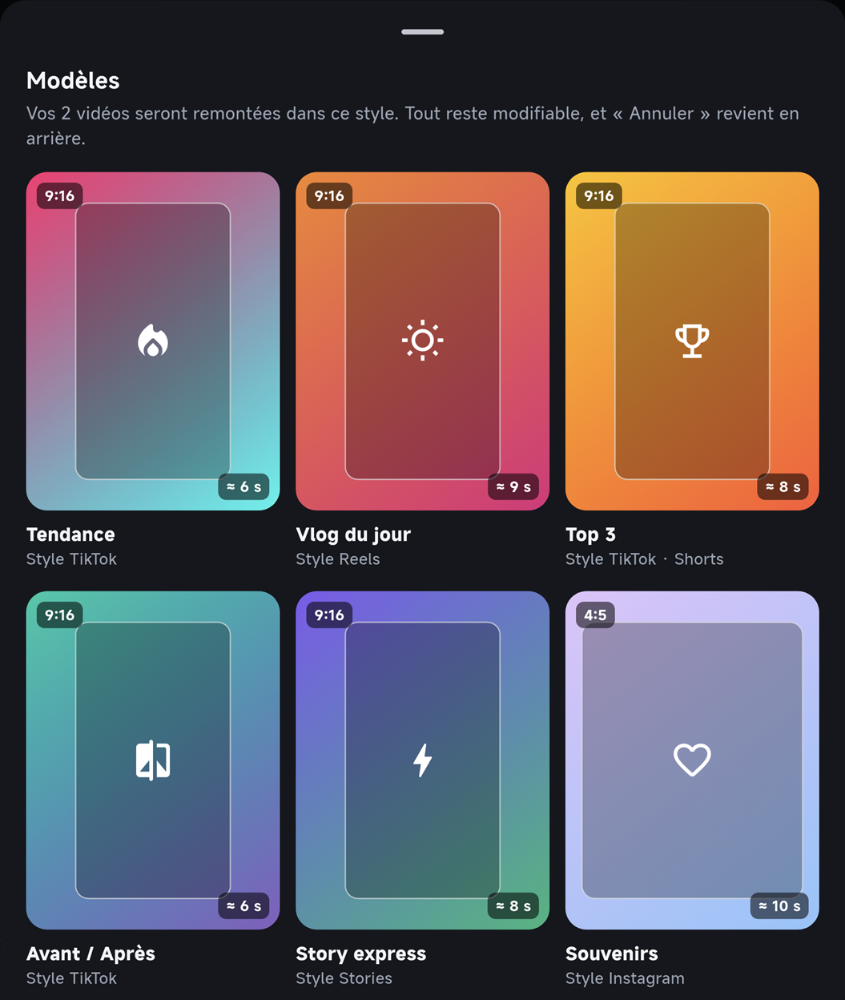
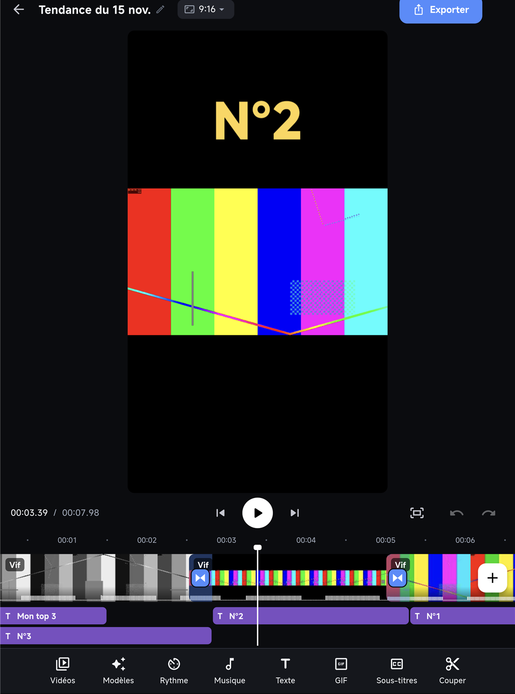

  

<h1 align="center">Raccord</h1>

  <b>Le montage vidéo sur Android, entièrement sur votre appareil.</b> 
  Pas de compte, pas de nuage, pas de filigrane : vos vidéos ne quittent jamais votre téléphone.

  <a href="../../releases/latest"><b>⬇ Télécharger la dernière version</b></a>

---

## Ce que fait Raccord

### Monter vite

- **Montage automatique** : choisissez vos vidéos, Raccord trouve le style qui leur va, garde les passages les plus vivants et cale les coupes sur la musique.
- **34 modèles** inspirés des réseaux (TikTok, Reels, Stories, YouTube…), rangés par thème : tendances, quotidien, voyage, fêtes, sport, cinéma, pro.
- **16 thèmes** (Anniversaire, Noël, Vacances, Mariage, Cinéma, Halloween, Rétro VHS…) : filtre, transitions, style des textes, titre d'ouverture et bruitage appliqués d'un coup à tout le montage.
- **Coupes sur le rythme** : Raccord trouve le tempo de votre musique et cale les coupes sur les temps.

### Monter finement

- **Vidéos et photos** de toutes qualités (jusqu'à la 4K, HDR compris), mélangées librement. Les photos s'animent d'un **zoom lent ou d'un panoramique**, un effet aussi disponible sur les vidéos.
- **Incrustations** (vidéo dans la vidéo) : un coin, un écran partagé en deux, ou le plein cadre ; à placer au doigt et à redimensionner en pinçant.
- **23 filtres de style** (Teal & Orange, Film noir, Vintage, VHS, Super 8, Néon…) avec aperçu sur votre image, et des réglages fins : lumière, contraste, saturation, température, teinte, noirs délavés, vignette, grain, virage.
- **Bandes noires façon cinéma**, qui glissent depuis les bords à l'entrée et à la sortie.
- Couper, rogner, réordonner, vitesse (ralenti/accéléré), transitions, formats 9:16, 16:9, 1:1, 4:5, 21:9, fond flou.

### Textes, autocollants et son

- **Textes stylés** : 16 styles prêts à l'emploi (surligné façon TikTok, contour, néon, étiquette, rétro 3D…) et des animations d'apparition.
- **Sous-titres automatiques**, reconnus sur l'appareil, hors ligne. Ils suivent la parole quand vous coupez ou déplacez un clip.
- **59 autocollants** (émojis, badges, flèches, bulles, éléments des réseaux) et des **GIF animés**.
- **Bruitages** : une soixantaine créés par l'application (whoosh, boum, ta-da, applaudissements, ambiances pluie, vagues, feu de camp…) et plus de 600 sons enregistrés, à écouter avant de les poser.
- **Musique** de l'appareil, ou le **son d'une vidéo** récupéré seul ; volume et fondus pour chaque piste.

### Exporter

- **MP4** jusqu'à la définition d'origine (4K comprise), en 24, 30 ou 60 images par seconde, qualité standard ou haute ; l'export continue en arrière-plan.

## Captures

  
  
  

## Installer

1. Ouvrez la [dernière version](../../releases/latest) depuis votre téléphone et téléchargez le fichier `Raccord-x.y.z.apk`.
2. Ouvrez-le. Android demande d'autoriser l'installation depuis votre navigateur : acceptez, puis installez.
3. C'est tout. Raccord n'a besoin ni de compte ni de connexion pour fonctionner.

**Appareils compatibles :** Android 13 ou plus récent, processeur 64 bits (ARM). Pensé pour les téléphones et tablettes récents.

### Mettre à jour

Quand une nouvelle version est publiée, un **point rouge** apparaît sur l'engrenage de l'écran d'accueil. Ouvrez les réglages et touchez **Télécharger**, puis installez l'APK par-dessus l'application : vos projets sont conservés.

## Vie privée

- Vos vidéos, musiques et projets restent sur l'appareil. Le montage, l'export et les sous-titres fonctionnent sans connexion.
- Seules deux fonctions utilisent Internet, et seulement si vous le souhaitez :
  - la **vérification des mises à jour** : une fois par jour au plus, une requête anonyme demande à GitHub le numéro de la dernière version. Elle se désactive dans les réglages ;
  - la **recherche de GIF** sur GIPHY, avec votre propre clé.
- Aucune publicité, aucune statistique d'usage, aucun traceur.

## À propos de ce dépôt

Ce dépôt sert à distribuer Raccord : il contient les versions à télécharger (onglet *Releases*) et cette présentation. **Le code source de l'application n'est pas publié.**

Vous avez trouvé un problème ou une idée ? Ouvrez une [*issue*](../../issues).

## Licences

Raccord © 2026, tous droits réservés.

Raccord embarque des composants libres, dont la liste complète figure dans l'application (*Réglages › Licences*) et dans [LICENCES-TIERS.md](LICENCES-TIERS.md), notamment :

- [whisper.cpp](https://github.com/ggml-org/whisper.cpp) et ggml (licence MIT), pour la reconnaissance vocale ;
- le modèle [Whisper](https://github.com/openai/whisper) « base » d'OpenAI (licence MIT) ;
- [Flutter](https://flutter.dev) (licence BSD).
