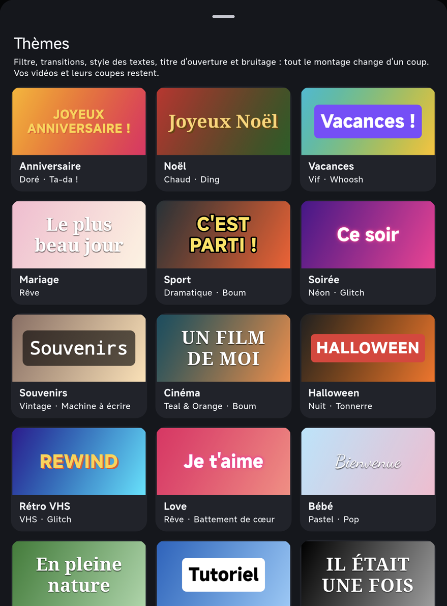
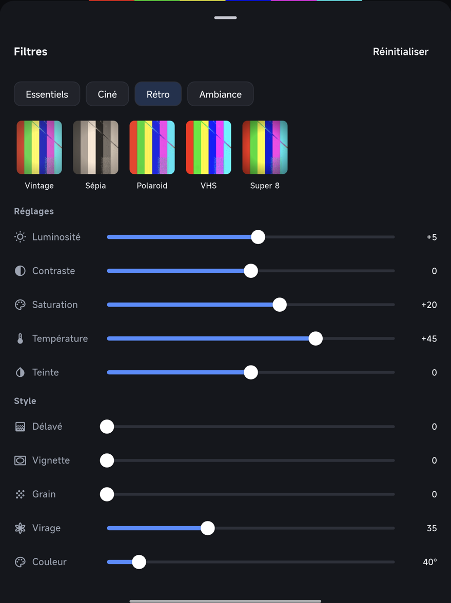
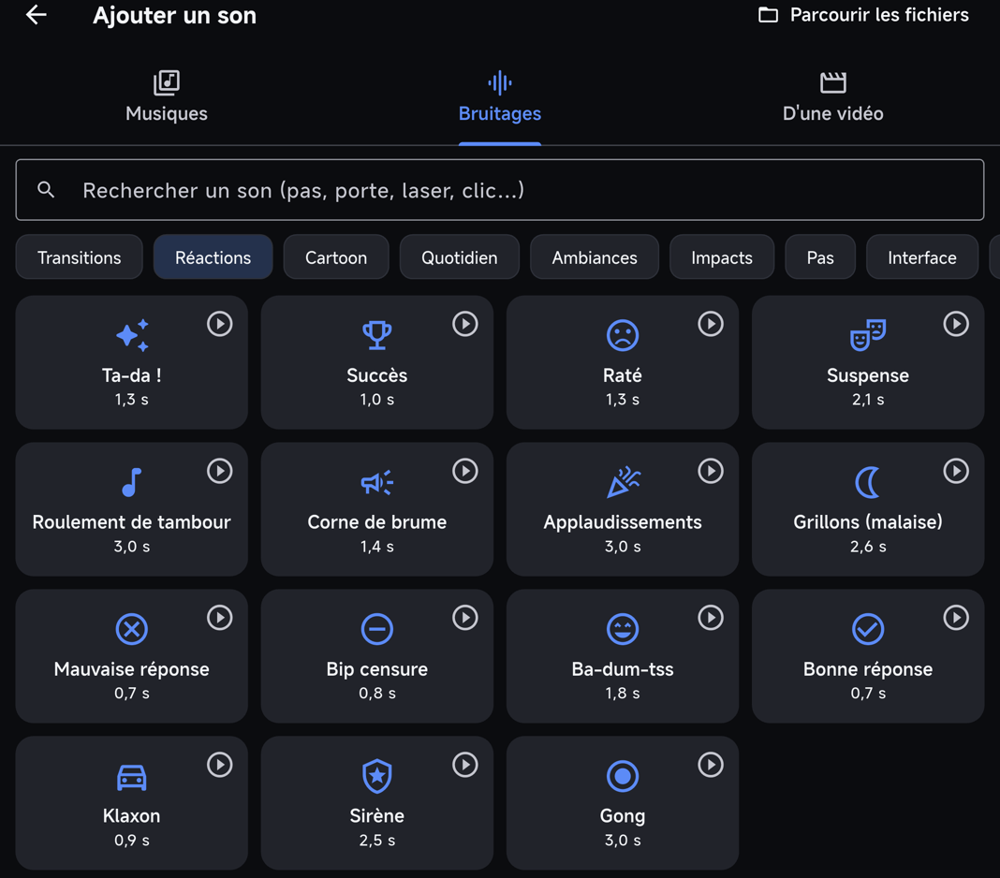

  

<h1 align="center">Raccord</h1>

<h3 align="center">Des vidéos dignes des réseaux, montées en quelques minutes. Gratuit. Sans compte. Sans filigrane. Et vos vidéos ne quittent jamais votre téléphone.</h3>

  
  
  

  <a href="../../releases/latest"><b>⬇&nbsp;&nbsp;Télécharger Raccord gratuitement</b></a>

  
  
  

---

## Pourquoi Raccord ?

| | |
|---|---|
| ⚡ **Rapide** | Choisissez vos vidéos : le **montage automatique** trouve le style, garde les meilleurs passages et coupe sur le rythme de la musique. Il ne vous reste qu'à publier. |
| 🎬 **Complet** | Thèmes, filtres de cinéma, textes animés, sous-titres, incrustations, bruitages, export 4K : tout ce qu'il faut pour TikTok, Reels, Shorts ou Stories. |
| 🔒 **Privé** | Tout se passe **sur votre appareil**, même hors ligne. Aucune vidéo n'est envoyée sur Internet, aucun compte n'est demandé. |
| 🎁 **Vraiment gratuit** | Pas d'abonnement, pas de fonctions bloquées, pas de publicité, **pas de filigrane** sur vos vidéos. |

---

## Montez en un geste

**Montage automatique.** Sélectionnez vos vidéos et laissez faire : Raccord analyse le son et l'image, choisit un style adapté, garde les moments les plus vivants et cale chaque coupe sur la musique.

**34 modèles inspirés des réseaux** (TikTok, Reels, Stories, YouTube…), rangés par envie : tendances, quotidien, voyage, fêtes, sport, cinéma, pro.

**16 thèmes complets.** Anniversaire, Noël, Vacances, Mariage, Cinéma, Halloween, Rétro VHS… Un toucher change tout le montage d'un coup : filtre, transitions, style des textes, titre d'ouverture et bruitage.

## Donnez-lui du style

<table>
<tr>
<td width="50%">

**23 filtres de style** avec aperçu sur votre propre image : Teal & Orange, Blockbuster, Film noir, Vintage, VHS, Super 8, Néon, Pastel…

Et pour les perfectionnistes : lumière, contraste, saturation, température, teinte, noirs délavés, vignette, grain argentique et virage de couleur.

**Bandes noires façon cinéma**, qui glissent depuis les bords.

**Zoom lent et panoramique** sur les photos comme sur les vidéos.

</td>
<td width="50%"></td>
</tr>
</table>

**Incrustations.** Une vidéo dans la vidéo : réaction dans un coin, **écran partagé** en deux, ou plein cadre. Placez-la au doigt, pincez pour la redimensionner.

**Textes qui claquent.** 16 styles prêts à l'emploi (surligné façon TikTok, contour, néon, étiquette, rétro 3D…), animations d'apparition, et **sous-titres automatiques** reconnus hors ligne, qui suivent la parole quand vous coupez.

**59 autocollants** (émojis, badges, flèches, bulles, éléments des réseaux) et vos **GIF animés**.

## Le son qui fait la différence

<table>
<tr>
<td width="50%"></td>
<td width="50%">

**Plus de 650 bruitages**, à écouter avant de les poser : whoosh, boum, ta-da, roulement de tambour, applaudissements, pas, portes, lasers, jingles… et des **ambiances** (pluie, vagues, vent, feu de camp).

**Votre musique** ou **le son d'une vidéo**, récupéré seul. Volume et fondus pour chaque piste.

**Coupes sur le rythme** : Raccord trouve le tempo et aligne les coupes sur les temps.

</td>
</tr>
</table>

## Pensé pour être vu

**Guide des zones des réseaux.** En filigrane sur l'aperçu, Raccord vous montre ce que TikTok, Reels ou Shorts recouvrent : boutons j'aime, commentaire et partage, nom et légende. Il vous indique aussi où placer le visage. Plus aucun texte caché sous un bouton. Le guide n'apparaît jamais dans la vidéo exportée.

**Tous les formats** : 9:16, 16:9, 1:1, 4:5, 21:9, avec fond flou si besoin.

**Export MP4 jusqu'en 4K**, en 24, 30 ou 60 images par seconde, qui continue en arrière-plan.

---

## Installer en 1 minute

1. Sur votre téléphone, ouvrez la **[dernière version](../../releases/latest)** et touchez le fichier `Raccord-x.y.z.apk`.
2. Ouvrez-le. Android vous demande d'autoriser l'installation depuis votre navigateur : acceptez, puis **Installer**.
3. C'est prêt. Ni compte, ni connexion nécessaires.

**Compatible :** Android 13 ou plus récent, processeur 64 bits. Pensé pour les téléphones et tablettes récents.

**Mises à jour :** quand une nouvelle version sort, un **point rouge** apparaît sur l'engrenage de l'accueil. Un toucher pour la télécharger, et elle s'installe par-dessus : vos projets sont conservés.

---

## Questions fréquentes

<b>C'est vraiment gratuit ?</b>

 
Oui. Pas d'abonnement, pas d'achat intégré, pas de publicité, et aucun filigrane ajouté à vos vidéos.

<b>Mes vidéos sont-elles envoyées quelque part ?</b>

 
Non. Le montage, l'export et les sous-titres automatiques se font entièrement sur votre appareil, même en mode avion. Raccord n'a pas de serveur.

<b>Pourquoi l'application n'est-elle pas sur le Play Store ?</b>

 
Raccord est distribué directement ici, sous forme de fichier APK. Chaque version est signée avec la même clé : Android vérifie ainsi que les mises à jour viennent bien de nous.

<b>Quelles vidéos puis-je importer ?</b>

 
Celles de votre téléphone, de toutes qualités (jusqu'à la 4K, HDR compris), ainsi que vos photos, vos musiques et vos GIF. Vous pouvez les mélanger librement dans un même montage.

<b>Les bruitages et les filtres sont-ils libres de droits ?</b>

 
Oui. Les bruitages sont créés par l'application ou proviennent de banques placées dans le domaine public (CC0). Vous pouvez publier vos vidéos sans souci de droits sur ces sons.

---

## Vie privée

- Vos vidéos, musiques et projets **restent sur l'appareil**.
- Seules deux fonctions utilisent Internet, et seulement si vous le voulez :
  - la **vérification des mises à jour** : au plus une fois par jour, une requête anonyme demande à GitHub le numéro de la dernière version. Elle se désactive dans les réglages ;
  - la **recherche de GIF** sur GIPHY, avec votre propre clé.
- **Aucune publicité, aucune statistique d'usage, aucun traceur.**

## Un problème, une idée ?

Ouvrez une [*issue*](../../issues) : chaque retour aide à améliorer Raccord.

Ce dépôt distribue l'application (onglet *Releases*) et cette présentation. Le code source n'est pas publié.

## Licences

Raccord © 2026, tous droits réservés.

Raccord embarque des composants libres, listés dans l'application (*Réglages › Licences*) et dans [LICENCES-TIERS.md](LICENCES-TIERS.md), notamment :

- [whisper.cpp](https://github.com/ggml-org/whisper.cpp) et ggml (licence MIT), et le modèle [Whisper](https://github.com/openai/whisper) d'OpenAI (licence MIT), pour les sous-titres ;
- les sons de [Kenney](https://kenney.nl) (domaine public, CC0) ;
- [Flutter](https://flutter.dev) (licence BSD).
